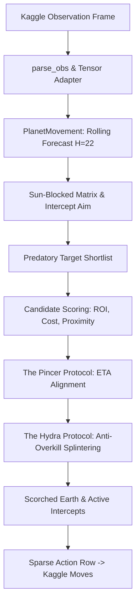

# OrbitWars: High-Performance Autonomous Strategy AI

[](https://www.python.org/downloads/)
[](https://pytorch.org/)
[](https://www.kaggle.com/)
[](#core-engine-architecture-orbit_lite)
[](#tactical-protocols--innovations)

An elite, tensor-accelerated autonomous agent engineered for Kaggle's **Orbit Wars** environment (`kaggle_environments.envs.orbit_wars.orbit_wars`). The engine combines GPU/CPU-vectorized orbital mechanics forecasting, non-linear ballistic intercept aiming, mathematical multi-wave tactical planning, and synchronized offensive protocols designed for 2-player and 4-player Free-For-All (FFA) domination.

---

## Table of Contents

- [1. Game Physics & Environment Mechanics](#1-game-physics--environment-mechanics)
  - [Orbital Dynamics](#orbital-dynamics)
  - [The Central Sun Kill Zone](#the-central-sun-kill-zone)
  - [Non-Linear Fleet Velocity](#non-linear-fleet-velocity)
  - [Celestial Comets](#celestial-comets)
- [2. Core Engine Architecture (`orbit_lite`)](#2-core-engine-architecture-orbit_lite)
  - [Vectorized Movement Forecast (`movement.py`)](#vectorized-movement-forecast-movementpy)
  - [Ballistic Intercept Aiming (`intercept_aim.py`)](#ballistic-intercept-aiming-intercept_aimpy)
  - [Vectorized Wave & Target Optimization (`planner_core.py`)](#vectorized-wave--target-optimization-planner_corepy)
- [3. Tactical Protocols & Innovations](#3-tactical-protocols--innovations)
  - [The Hydra Protocol (Anti-Overkill Multi-Targeting)](#the-hydra-protocol-anti-overkill-multi-targeting)
  - [The Pincer Protocol (ETA-Synchronized Strikes)](#the-pincer-protocol-eta-synchronized-strikes)
  - [Cost-Aware Predatory Targeting](#cost-aware-predatory-targeting)
  - [Scorched Earth Protocol (Doomed Planet Evacuation)](#scorched-earth-protocol-doomed-planet-evacuation)
  - [Dynamic Reinforcement & Active Interception](#dynamic-reinforcement--active-interception)
- [4. The Defensive Dilemma (V14 vs V22 Insights)](#4-the-defensive-dilemma-v14-vs-v22-insights)
- [5. Repository Structure](#5-repository-structure)
- [6. Benchmarking, Gauntlet & Forensics Suite](#6-benchmarking-gauntlet--forensics-suite)
  - [Local Simulation & Replay Generation](#local-simulation--replay-generation)
  - [Multi-Threaded Parallel Gauntlet](#multi-threaded-parallel-gauntlet)
  - [Post-Mortem Replay Analysis](#post-mortem-replay-analysis)
- [7. Reinforcement Learning & Self-Play Exploration](#7-reinforcement-learning--self-play-exploration)
- [8. Kaggle Packaging & Deployment](#8-kaggle-packaging--deployment)
- [9. Configuration & Hyperparameters](#9-configuration--hyperparameters)
- [10. Quickstart & Installation](#10-quickstart--installation)

---

## 1. Game Physics & Environment Mechanics

In Orbit Wars, 2 to 4 commanders compete across a 500-step match to claim planetary dominance across an orbital plane.

```
       .  *       +     .     *         .   
             \       |       /   
          O   \      |      /    O  (Orbiting Planets)
               \     |     /    
        --------- [ SUN ] ---------  (Radius: 10.0 at 50, 50)
               /     |     \    
          O   /      |      \    O  
             /       |       \  
       *  .       +     .        *   .  
```

### Orbital Dynamics
* **Board Dimensions**: $100.0 \times 100.0$ continuous space centered at $(50.0, 50.0)$.
* **Planetary Orbits**: Planets rotate about the Sun with constant angular velocity determined by their orbital radius ($r_{\text{orbit}} \le 50.0$).
* **Planetary Yield & Garrison**: Each planet produces ships each turn (`prod`) and holds a defending garrison (`ships`). Capture requires an attacking fleet to arrive with strictly more ships than the garrison at arrival time.

### The Central Sun Kill Zone
* Located at $(50.0, 50.0)$ with radius $R_{\text{sun}} = 10.0$.
* **Instant Annihilation**: Any fleet whose linear trajectory intersects the sun circle is instantly destroyed.
* `orbit_lite` performs vectorized line-segment to circle distance raycasts (`build_sun_blocked_matrix`), masking out any illegal trajectories prior to candidate generation.

### Non-Linear Fleet Velocity
Fleet speed is not constant; larger armadas travel drastically faster according to a logarithmic scaling curve:

$$v(\text{ships}) = 1.0 + (V_{\max} - 1.0) \cdot \left(\frac{\ln(\text{ships})}{\ln(1000)}\right)^{1.5}$$

where $V_{\max} = 6.0$.

| Fleet Size | Velocity (units/step) | Relative Speed | Travel Time (50 units) |
|:---:|:---:|:---:|:---:|
| 1 ship | 1.00 | 1.0x (Slowest) | 50.0 turns |
| 10 ships | 1.95 | ~2.0x | 25.6 turns |
| 50 ships | 3.24 | ~3.2x | 15.4 turns |
| 100 ships | 4.16 | ~4.2x | 12.0 turns |
| 500 ships | 5.51 | ~5.5x | 9.1 turns |
| 1000+ ships | 6.00 | 6.0x (Max) | 8.3 turns |

> Naive linear bots assume constant velocity and fail catastrophically because their fleets arrive tens of turns late or miss orbiting planets entirely.

### Celestial Comets
Comets spawn in bursts at designated turn intervals (steps 50, 150, 250, 350, 450). Each event spawns 4 comets with radius $1.0$ and base production $1.0$. The engine tracks comet trajectories to seize temporary economic hubs while evading mid-flight collisions.

---

## 2. Core Engine Architecture (`orbit_lite`)



### Vectorized Movement Forecast (`movement.py`)
`PlanetMovement` is a PyTorch-accelerated rollout cache that projects all planetary coordinates $(x_t, y_t)$ across an $H$-step horizon ($H=22$ steps into the future).
* Calculates exact planetary positions using analytical trigonometric propagation.
* Maintains 3D arrival buckets `[P, H, A]` tracking incoming friendly and hostile ship arrivals at every future timestep.
* Projects garrison evolutions including production and combat resolution ahead of time.

### Ballistic Intercept Aiming (`intercept_aim.py`)
Because target planets move in circular orbits while fleets travel in straight lines at variable velocities, simple `atan2(dy, dx)` targeting fails. 
* The solver iterates over future timesteps $t \in [1, H]$.
* At each step $t$, it evaluates whether a fleet of size $S$ launched at step $0$ can reach target planet boundary $R_{\text{target}}$ at $(x_t, y_t)$.
* Solves the exact lead angle $\theta$ and flight duration $\text{ETA}$, eliminating orbital deflection errors.

### Vectorized Wave & Target Optimization (`planner_core.py`)
* Evaluates all valid source-target pairs across $P$ planets.
* Filters blocked trajectories (Sun raycasts) and targets with negative return-on-investment (ROI).
* Solves greedy wave assignments respecting source budgets, preventing duplicate fleet exhaustion, and maintaining role mutual exclusion (a planet being reinforced cannot simultaneously be drained as a launch base).

---

## 3. Tactical Protocols & Innovations

### The Hydra Protocol (Anti-Overkill Multi-Targeting)
* **The Problem**: Standard bots dump 100% of a planet's available ships into a single attack. If a 600-ship fortress targets a 15-ship neutral planet, 600 ships are launched, zeroing the planet's budget and stalling expansion.
* **The Solution**: The engine calculates the **Capture Floor** ($N_{\text{req}}$) required to conquer the planet at arrival time, adding a narrow safety buffer:

$$\text{Optimal Send} = \text{CaptureFloor} + \min(\text{Surplus} \times 0.10, 25.0)$$

* **The Result**: A 600-ship fortress sends 35 ships to take Target A, then uses its remaining 565 budget to simultaneously strike Target B, Target C, and Target D on the exact same turn.

```
                    ┌─── [35 Ships] ───> Target A (Neutral)
                    ├─── [40 Ships] ───> Target B (Weak Enemy)
[600-Ship Fortress] ├─── [85 Ships] ───> Target C (Contested)
                    └─── [440 Held / Next Wave]
```

### The Pincer Protocol (ETA-Synchronized Strikes)
* **The Problem**: When coordinating multi-base assaults against high-defense enemy citadels, nearby planets launch immediately and arrive early, dying in piecemeal waves (*Defeat in Detail*).
* **The Solution**: When a wave comprises multiple launch lanes, the engine computes:

$$\text{ETA}_{\max} = \max_{i \in \text{active}} (\text{ETA}_i)$$

* Launches with $\text{ETA}_i < \text{ETA}_{\max} - 0.5$ are deferred until subsequent turns.
* **The Result**: Disparate fleets launched from different orbital rings arrive at the target planet on the **exact same tick**, combining their firepower into an unstoppable single-turn capture.

### Cost-Aware Predatory Targeting
Target shortlisting prioritizes high-production targets while heavily penalizing fortified defenses:

$$\text{Score}(t) = -\text{Proximity} + 4.0 \cdot \text{Prod}(t) - 0.05 \cdot \text{Garrison}(t)$$

The bot systematically cleanses weak, high-yield planets before committing armies against heavy enemy fortresses, maximizing economic snowball while denying opponents resource bases.

### Scorched Earth Protocol (Doomed Planet Evacuation)
When incoming hostile fleets mathematically exceed all possible reinforcement capabilities, defending is a sunk cost.
* Identifies doomed planets before enemy landing.
* Bypasses pressure-gradient locks and launches 100% of the garrison to safe inland bases.
* Leaves $0.0$ ships for the enemy upon arrival, completely denying kill count and salvaging armies for immediate counter-offensives.

### Dynamic Reinforcement & Active Interception
* Projects incoming enemy waves up to 22 steps in advance.
* Automatically schedules friendly reinforcement packets to arrive 1 step before enemy arrival, defending crucial high-production infrastructure without idling ships on perimeter bases.

---

## 4. The Defensive Dilemma (V14 vs V22 Insights)

During extensive tournament ablation testing, a conservative defensive doctrine was tested against the hyper-aggressive baseline:

| Strategy Configuration | 4-Player FFA Win Rate | Performance Diagnostic |
|---|:---:|---|
| **Defensive Retention** (`retention = 3 * prod`, `overhead = 1.2`) | **5.0%** (1W / 19L) | **Catastrophic Failure**: Over-defending kept ships idle. Opponents captured neutral planets uncontested, achieved 3x production superiority, and overwhelmed perimeter bases. |
| **Pure Aggression + Predatory Flow** (V14/V27 baseline) | **35.0%** (7W / 13L) | **Dominant**: Rapid expansion and aggressive economic starvation outperformed the 25% 4-player FFA baseline. |

> **Key Takeaway**: In Orbit Wars multiplayer, **aggressive expansion is the only viable defense**. Hoarding ships on borders loses games. Safety is achieved through production dominance and surgical active interception, not static garrisons.

---

## 5. Repository Structure

```
OrbitWars/
├── README.md                      # Comprehensive project documentation
├── read.md                        # Quick-access mirror of documentation
├── .gitignore                     # Git ignore rules for models, replays & logs
├── .kaggleignore                  # Kaggle bundle packaging exclusions
├── agent.py                       # Minimal baseline greedy agent
├── package_submission.py          # Script to package submission tarballs
├── push_to_kaggle.py              # Automated Kaggle API deployment script
├── simulate.py                    # Fast 2-player local simulation with HTML replay
│
├── buddy_model/                   # PRODUCTION AGENT CORE (Current Release)
│   ├── main.py                    # Entry point: observation adapter, Hydra & wave planner
│   └── orbit_lite/                # High-performance tensor mechanics engine
│       ├── __init__.py            # Module exports
│       ├── adapter.py             # Observation tensor mapping & sparse action encoder
│       ├── aiming.py              # Angular trigonometry utilities
│       ├── constants.py           # Physical constants, board bounds, comet timings
│       ├── distance_cache.py      # Pairwise distance computation & indexing
│       ├── garrison_launch.py     # Garrison projection & dynamic launch budget tracking
│       ├── geometry.py            # Non-linear fleet velocity & vector kinematics
│       ├── intercept_aim.py       # Ballistic lead angle & flight time solver
│       ├── movement.py            # PlanetMovement: rolling H=22 state forecast
│       ├── movement_aiming.py     # Intercept aiming bound to orbital forecasts
│       ├── movement_step.py       # Launch entries, planned launches, deduplication
│       ├── obs.py                 # Observation parsing & dataclass container
│       └── planner_core.py        # Pincer, Scorched Earth, Predatory Shortlisting
│
├── best_submission/               # Stable historical tournament benchmark
│   ├── main.py
│   └── orbit_lite/
│
├── v14_bot/                       # Reference bot: V14 hyper-aggressive engine
├── v15_bot/                       # Reference bot: V15 calibrated parameters
├── v22_bot/                       # Reference bot: V22 stabilized engine
│
├── battle_arena.py                # Head-to-head evaluation arena
├── run_parallel_gauntlet.py       # Multi-process 4-player FFA tournament runner
├── analyze_mistakes_v22.py        # Automated turn-by-turn mistake pattern forensic engine
├── analyze_replay.py              # Replay JSON parser & strategic metric extractor
├── analyze_losses.py              # Failure mode categorizer
│
├── train.py                       # PPO reinforcement learning training loop (W&B enabled)
├── rl_env.py                      # Gymnasium-compatible Orbit Wars RL environment
└── rl_tuner_env.py                # Meta-heuristic hyperparameter optimization environment
```

---

## 6. Benchmarking, Gauntlet & Forensics Suite

### Local Simulation & Replay Generation
To run a fast local game between two agents and produce an interactive HTML visualizer:

```powershell
python simulate.py
```
This writes `replay.html`. Open `replay.html` directly in any web browser to view the game frame-by-frame, inspect orbits, analyze ship counts, and evaluate trajectory paths.

### Multi-Threaded Parallel Gauntlet
To benchmark your candidate agent against historical baselines (V14, V15, V22) across randomized map seeds using `ProcessPoolExecutor`:

```powershell
python run_parallel_gauntlet.py
```

### Post-Mortem Replay Analysis
When an agent drops a game, run the forensic analyzer to extract per-turn diagnostic telemetry:

```powershell
python analyze_mistakes_v22.py
```
Detects:
* **Overkill Launches**: Fleets that dispatched excessive ships when a smaller fraction sufficed.
* **Sun Intersections**: Fleets launched into the central sun hazard.
* **Missed Interceptions**: Enemy captures that could have been saved by available nearby garrisons.
* **Idle High-Production Garrisons**: Surplus ships accumulated on backline planets.

---

## 7. Reinforcement Learning & Self-Play Exploration

The repository contains a full Proximal Policy Optimization (PPO) pipeline using `stable-baselines3`:

* **Environment (`rl_env.py`)**: Wraps `kaggle-environments` into a vectorized step interface with custom reward shaping (planet control, ship differential, production momentum).
* **Self-Play Training (`train.py`)**:
  * Saves periodic model checkpoints into `historical_models/`.
  * Dynamically samples opponents from historical checkpoints to prevent policy overfitting.
  * Integrates with Weights & Biases (`wandb`) for real-time loss and reward tracking.

To launch a training run:

```powershell
python train.py
```

---

## 8. Kaggle Packaging & Deployment

### Packaging Rules
Kaggle's environment uncompresses submission archives directly into the working directory `/kaggle_simulations/agent/`. **Nested root imports will fail.** 

```
# CORRECT ARCHIVE STRUCTURE:
submission.tar.gz
├── main.py
└── orbit_lite/
    ├── __init__.py
    ├── movement.py
    └── ...
```

### Packaging Command

To generate a pristine release archive:

```powershell
tar -czf final_submission_v12.tar.gz -C buddy_model main.py orbit_lite
```

Alternatively, use the automated packager:

```powershell
python package_submission.py
```

### Deployment to Kaggle
Upload the archive directly to the Kaggle Orbit Wars competition interface, or automate deployment using `push_to_kaggle.py` (requires valid `kaggle.json` credentials in `~/.kaggle/`).

---

## 9. Configuration & Hyperparameters

Engine parameters are centrally declared in `ProducerLiteConfig` within [`buddy_model/main.py`](buddy_model/main.py):

| Parameter | Default | Strategic Purpose |
|---|:---:|---|
| `horizon` | `22` | Number of forward steps to simulate planet orbits and incoming arrivals. |
| `max_sources_per_lane` | `20` | Maximum contributing bases considered per attack wave. |
| `max_offensive_targets` | `20` | Target candidate shortlist size for offensive expansion. |
| `max_defensive_targets` | `4` | Target candidate shortlist size for active reinforcements. |
| `max_waves_per_turn` | `10` | Maximum distinct assault waves dispatched per turn. |
| `roi_threshold` | `1.5` | Minimum return-on-investment score required to authorize an attack. |
| `min_ships_to_launch` | `4.0` | Eliminates useless 1-3 ship fleets that travel at slow minimum velocity. |
| `enable_regroup` | `True` | Activates Scorched Earth doomed planet evacuation and backline staging. |
| `max_regroup_time` | `7.0` | Maximum allowable travel duration for defensive evacuation. |
| `regroup_pressure_delta_min` | `0.25` | Pressure gradient threshold separating contested borders from safe havens. |

---

## 10. Quickstart & Installation

### Prerequisites
* Python 3.10 or higher
* Recommended: Virtual environment (`venv` or `conda`)

### Installation

```powershell
# 1. Clone repository
git clone https://github.com/your-username/OrbitWars.git
cd OrbitWars

# 2. Create and activate virtual environment
python -m venv .venv
.\.venv\Scripts\activate

# 3. Install core dependencies
pip install torch --index-url https://download.pytorch.org/whl/cpu
pip install kaggle-environments numpy stable-baselines3 wandb
```

### Run Verification Match

```powershell
python simulate.py
```
After the run completes, inspect `replay.html` to confirm that the agent is calculating trajectories, synchronizing multi-base waves, and conquering orbits as designed.
